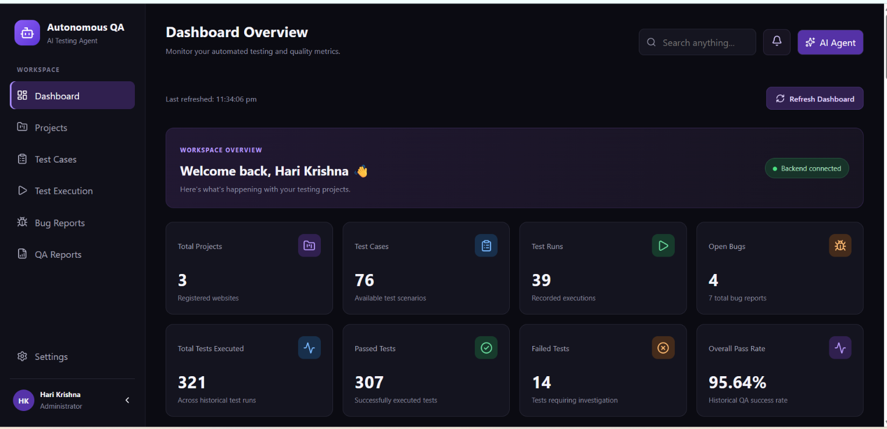
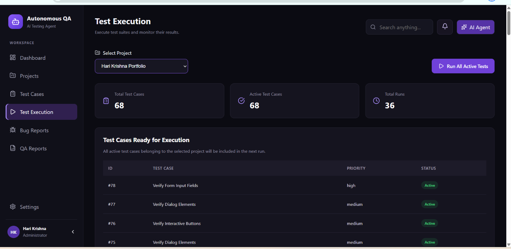
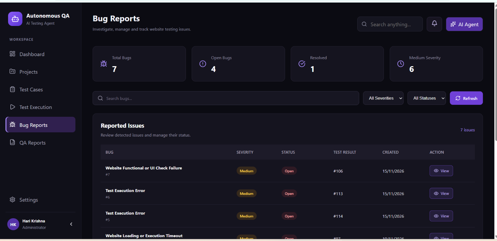
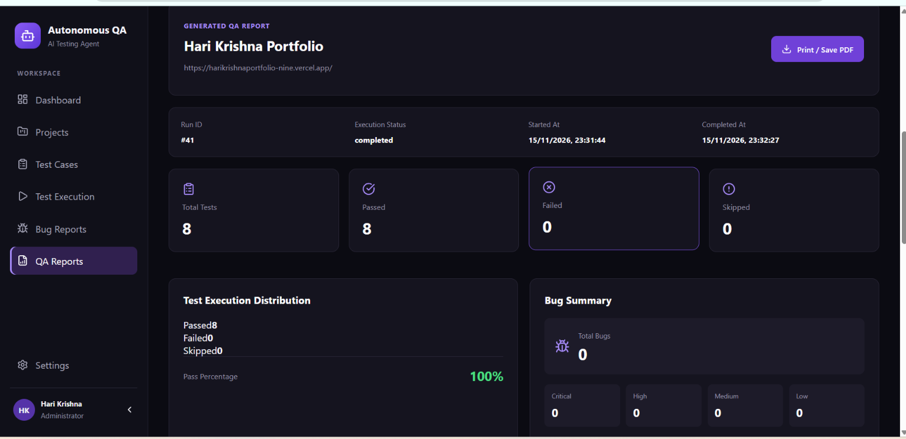
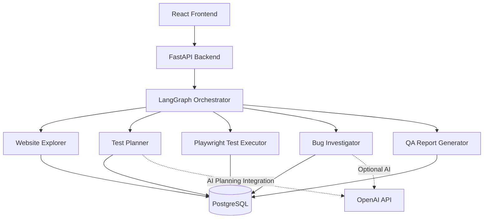

# Autonomous AI Testing & QA Agent

An intelligent web application testing platform that explores websites, generates test scenarios, executes automated browser tests, investigates failures, and generates QA reports.

<p align="center">
  
</p>

## Overview

The Autonomous AI Testing & QA Agent is designed to simplify website quality assurance through automated browser testing and an agent-based workflow.

Users can register websites, explore website content, generate test cases, execute test scenarios, track bugs, and generate detailed QA reports through a centralized dashboard.

## Key Features

- **Website Exploration:** Automatically explores website pages and discovers headings, sections, buttons, and interactive elements.
- **Test Case Generation:** Generates website testing scenarios using the local test planner and AI planning integration.
- **Automated Test Execution:** Executes browser-based tests using Playwright.
- **Bug Investigation:** Analyzes failed test results and creates structured bug reports.
- **AI Integration:** Includes an optional OpenAI-powered investigation path with rule-based fallback.
- **QA Reporting:** Generates reports containing test execution statistics and bug summaries.
- **Test History:** Stores projects, test cases, execution results, and reports in PostgreSQL.
- **Docker Deployment:** Runs the frontend and backend using Docker Compose.

## Application Screenshots

### 1. Dashboard

Overview of projects, test cases, test runs, bugs, and testing statistics.


### 2. Test Execution

Manage test scenarios and execute automated website tests.



### 3. Bug Reports

Review detected issues, severity levels, and investigation status.



### 4. QA Reports

View generated QA reports, execution summaries, and pass percentages.



## Technology Stack

| Component | Technologies |
|---|---|
| Frontend | React, JavaScript, CSS |
| Backend | Python, FastAPI |
| Browser Automation | Playwright |
| Agent Orchestration | LangGraph |
| AI Integration | OpenAI API |
| Database | PostgreSQL |
| ORM | SQLAlchemy |
| Containerization | Docker, Docker Compose |
| API Documentation | Swagger / OpenAPI |

## System Architecture



## Project Structure

```text
autonomous-qa-agent/
│
├── backend/
│   ├── app/
│   │   ├── agents/
│   │   ├── models/
│   │   ├── routers/
│   │   ├── schemas/
│   │   └── services/
│   ├── requirements.txt
│   └── Dockerfile
│
├── frontend/
│   ├── public/
│   ├── src/
│   │   ├── components/
│   │   └── pages/
│   └── Dockerfile
│
├── docs/
│   └── assets/
│       ├── dashboard.png
│       ├── test-execution.png
│       ├── bug-report.png
│       └── qa-reports.png
│
├── docker-compose.yml
├── .gitignore
└── README.md
```

## Installation and Setup

### Prerequisites

- Python 3.11+
- Node.js 24+
- PostgreSQL with the project database configured
- Docker Desktop with Docker Compose
- Git

### Option 1: Run using Docker

Clone the repository:

```bash
git clone https://github.com/Harikrishna-9133/autonomous-qa-agent.git
cd autonomous-qa-agent
```

Configure your backend environment variables in `backend/.env`.

Do not upload your `.env` file or API keys to GitHub.

Start the application:

```bash
docker compose up -d --build
```

Check running containers:

```bash
docker compose ps
```

### Option 2: Run locally

**Backend**

```powershell
cd backend
python -m venv venv
.\venv\Scripts\Activate.ps1
pip install -r requirements.txt
python -m uvicorn app.main:app --reload
```

**Frontend** (open another terminal):

```powershell
cd frontend
npm install
npm run dev
```

## Application URLs

| Service | URL |
|---|---|
| Frontend | http://localhost:5173 |
| Backend API | http://localhost:8000 |
| Swagger Documentation | http://localhost:8000/docs |
| Health Check | http://localhost:8000/health |

## Testing Results

A verified Docker-based regression run (Run #38) produced the following results:

| Metric | Result |
|---|---:|
| Total Tests | 8 |
| Passed | 8 |
| Failed | 0 |
| Skipped | 0 |
| Pass Rate | 100% |

These results represent the recorded regression run, not a guarantee that every website or test scenario will pass.

## Security Considerations

- Keep API keys and database credentials in environment variables.
- Do not commit `.env` files or database backups.
- Test only websites that you own or have permission to assess.
- Browser requests are validated to restrict access to local and private network addresses.
- Additional network isolation and production security hardening are required before exposing the platform publicly.

## Current Limitations

- Test planning and bug investigation include rule-based fallback implementations.
- Some test execution behavior is based on predefined checks and keyword-driven interpretation.
- OpenAI-powered investigation requires a valid API key and available API credits.
- The current Docker deployment is a development deployment, not a fully production-hardened service.

## Future Enhancements

- More autonomous natural-language test planning and execution.
- Retrieval-Augmented Generation (RAG) for historical bug knowledge.
- Advanced test coverage and analytics.
- Enhanced authentication and role-based access control.
- Isolated browser execution and stronger network security.
- CI/CD pipeline integration.

## Author

**Hari Krishna Digiventi**

GitHub: [Harikrishna-9133](https://github.com/Harikrishna-9133)

Project Repository: [Autonomous AI Testing & QA Agent](https://github.com/Harikrishna-9133/autonomous-qa-agent)

---

*Built to make website testing more automated, intelligent, and accessible.*